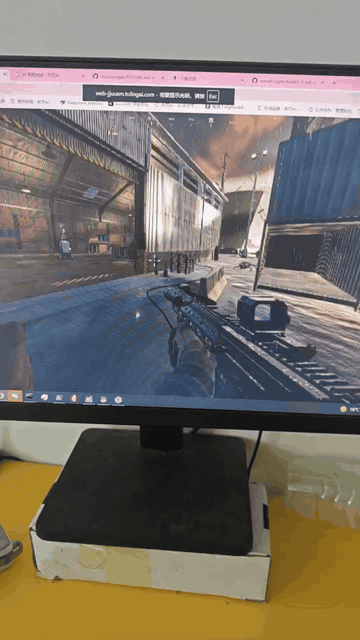
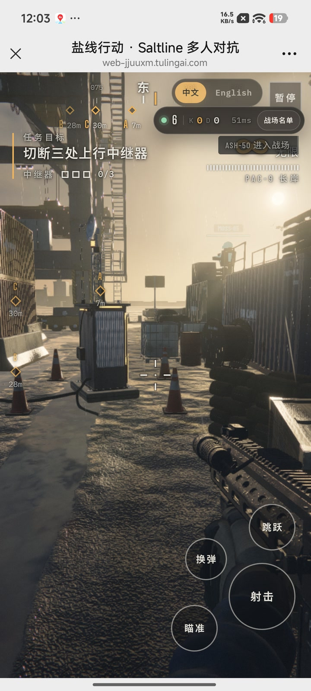
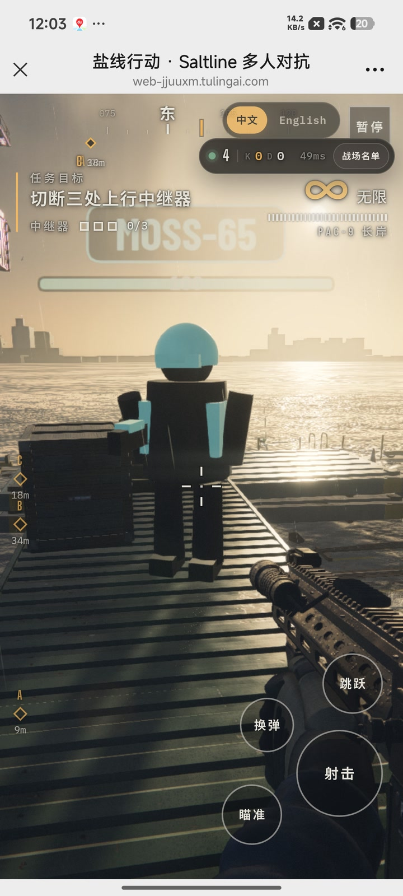
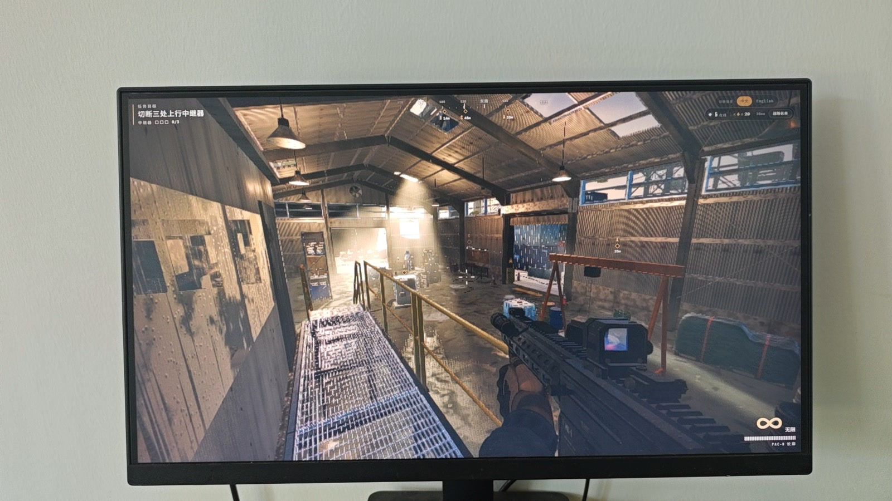
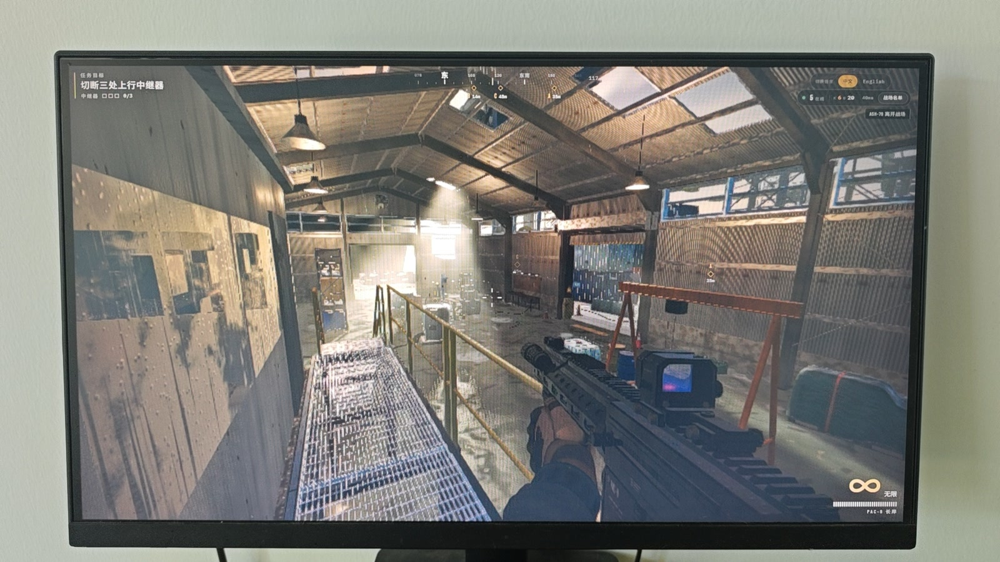
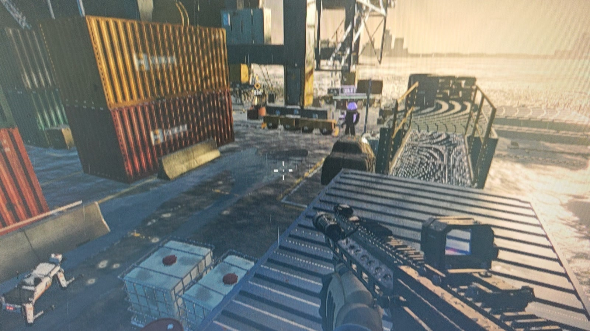
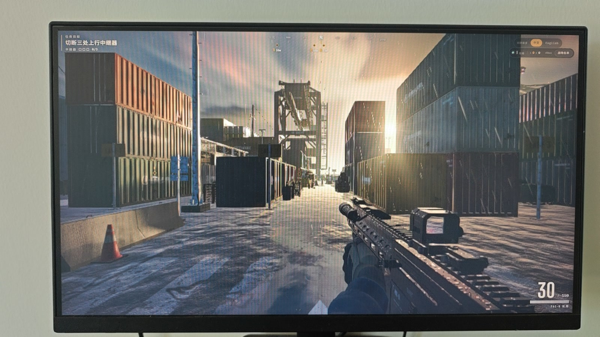

# 盐线行动 · Saltline

一款运行在浏览器中的多人在线 3D 港口枪战游戏。所有进入战场的玩家互为敌人，被击倒后等待 5 秒即可重新加入对战。

项目基于 Node.js、Express、WebSocket 与 Three.js 构建，无需数据库。排行榜保存在本地 `data/` 目录中。

## 游戏预览

<p align="center">
  <a href="docs/media/multiplayer-demo.mp4">
    
  </a>
</p>

<p align="center"><sub>多人联机实机演示 · 点击预览图查看视频</sub></p>

| 移动端任务界面 | 移动端多人对战 |
| --- | --- |
|  |  |

| 仓库室内场景 | 仓库高台场景 |
| --- | --- |
|  |  |

| 码头交火 | 集装箱通道 |
| --- | --- |
|  |  |

更多截图与视频素材位于 [`docs/media/`](docs/media/)。

## 功能

- 多人在线自由混战（free-for-all）
- 5 秒自动复活与 2 秒复活保护
- 服务端命中校验、生命值、击杀与战绩统计
- 实时玩家位置、射击表现和击杀信息
- 在线人数、战场名单与排行榜
- 中英文界面切换
- 桌面端与移动端响应式布局

## 环境要求

- Node.js 18 或更高版本
- npm 9 或更高版本
- 支持 WebGL 和 WebSocket 的现代浏览器

## 本地运行

```bash
npm install
cp .env.example .env
npm start
```

Windows PowerShell 可使用：

```powershell
Copy-Item .env.example .env
npm start
```

浏览器访问 `http://localhost:3000`。

## 环境变量

| 变量 | 默认值 | 说明 |
| --- | --- | --- |
| `PORT` | `3000` | HTTP 与 WebSocket 共用端口 |
| `HOST` | 代码回退为 `127.0.0.1` | 监听地址；`.env.example` 使用 `0.0.0.0`，便于本地和容器访问 |

`.env` 仅用于本地配置，不会提交到 Git。公开部署时请在平台的环境变量设置中配置实际值。

## 操作

| 操作 | 按键 |
| --- | --- |
| 移动 | `W` `A` `S` `D` |
| 观察 | 鼠标 |
| 射击 | 鼠标左键 |
| 瞄准 | 鼠标右键 |
| 换弹 | `R` |
| 跳跃 | `Space` |
| 冲刺 | `Shift` |
| 蹲伏 | `Ctrl` / `C` |
| 战场名单 | `Tab` |
| 暂停 | `Esc` |

## 项目结构

```text
.
├── config/                  # JSON 数据存储
├── controllers/             # 页面与游戏 API 控制器
├── data/                    # 运行时排行榜数据
├── locales/                 # 中英文文案
├── public/                  # 样式、游戏 bundle 与多人对战客户端
├── realtime/                # WebSocket 实时对战服务
├── routes/                  # HTTP API 路由
├── views/                   # EJS 页面模板
├── API.md                   # HTTP 与 WebSocket 接口文档
└── index.js                 # 应用入口
```

## 部署

生产环境可使用任意支持 Node.js 的平台。构建命令不是必需的，启动命令为：

```bash
npm install --omit=dev
npm start
```

平台需要允许 WebSocket 升级请求。HTTP 和 WebSocket 使用同一个 `PORT`。

## 数据持久化

排行榜写入 `data/leaderboard.json`，文件按原子方式更新，并保留击杀数最高的 300 条记录。`data/` 下的运行数据默认不进入 Git。容器部署若需要跨重启保留排行榜，请为该目录挂载持久化存储。

## 接口文档

HTTP API、WebSocket 协议、限流规则和消息示例见 [API.md](./API.md)。

## 第三方组件

服务端依赖及其版本见 `package-lock.json`。客户端包含打包后的 Three.js 与其他运行时代码，第三方组件分别遵循其原始许可证。发布或再分发时请同时保留相应许可声明。

## 许可证

本项目原创源码采用 [MIT License](./LICENSE) 开源。
